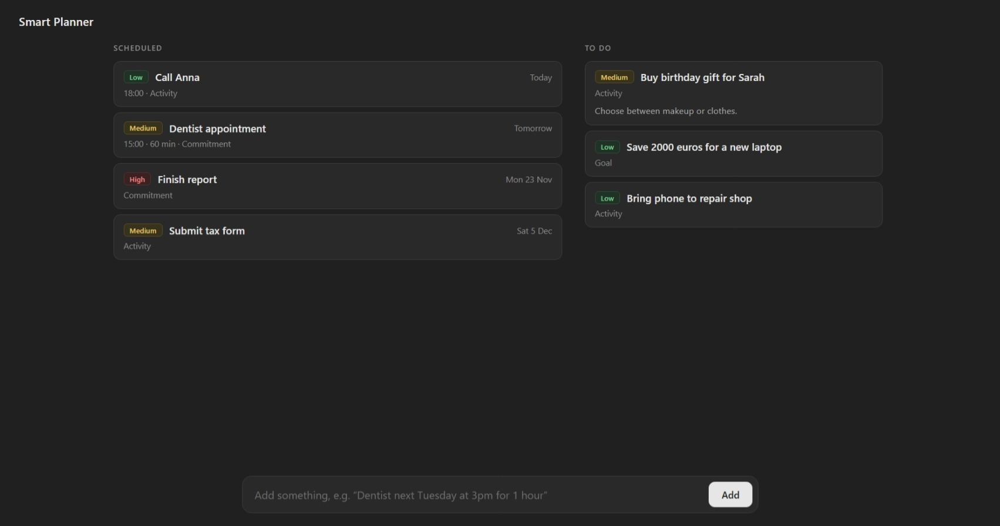

# Smart Planner

A minimal personal planner that turns **natural-language requests** into structured agenda items, using a **local LLM** through llama.cpp. Built with **Spring Boot** and **PostgreSQL**.

Type something like "Dentist tomorrow at 3pm for 1 hour" and the app creates a titled, dated and prioritized item. Everything runs locally: no cloud services and no API keys.

<p align="center">
  
</p>

## Features

- **Natural-language input**: describe an activity, goal or commitment in plain English, no forms.
- **Constrained output**: the model must answer with a JSON object that follows a schema enforced by llama.cpp, then the item is validated before saving.
- **Two lists**: items with a date go to *Scheduled*, ordered by date and time; items without one go to *To do*, ordered by priority.
- **Colour-coded priority**: red (high), yellow (medium), green (low).
- **Editable items**: click a card to change any field or delete it.
- **Dark, neutral interface**: plain HTML, CSS and JavaScript, served by Spring Boot.
- **Fully local**: your data stays in your PostgreSQL database, and the model runs on your machine.

## How it works

1. You type a request in the bar at the bottom of the page.
2. The browser sends it to `POST /api/agenda/interpret`.
3. The backend builds a system prompt with the current date and a 14-day calendar, and asks the local model for one agenda item as JSON.
4. The draft is returned to the browser, which saves it with `POST /api/events`.
5. The lists are redrawn.

Each item has a title, a type (`ACTIVITY`, `GOAL` or `COMMITMENT`), an optional date, time and duration, short notes and a priority (`LOW`, `MEDIUM` or `HIGH`). Date and time are meant to stay empty unless the request contains a time reference, so a plain task like "Renew the car insurance" lands in *To do*.

### API

| Method | Endpoint | Purpose |
| --- | --- | --- |
| `GET` | `/api/agenda/context` | Time zone and today's date. |
| `POST` | `/api/agenda/interpret` | Turns `{"text": "..."}` into an agenda item draft. |
| `GET` | `/api/events` | Lists all items. |
| `POST` | `/api/events` | Creates an item. |
| `PUT` | `/api/events/{id}` | Updates an item. |
| `DELETE` | `/api/events/{id}` | Deletes an item. |

## Project structure

```
Smart-Planner/
├── pom.xml
├── .env.example
├── docs/
│   └── screenshot.png
└── src/main/
    ├── java/planner/
    │   ├── SmartPlannerApplication.java
    │   ├── AgendaController.java       # REST endpoints
    │   ├── AgendaItem.java             # JPA entity, also used as JSON
    │   ├── AgendaItemRepository.java
    │   └── LlamaClient.java            # prompt, schema and llama.cpp call
    └── resources/
        ├── application.properties
        └── static/
            ├── index.html
            ├── app.js
            ├── styles.css
            └── Icon.png
```

## Installation

Requires **Java 21**, **Maven**, a running **PostgreSQL** server and [**llama.cpp**] with a chat model in GGUF format.

```bash
git clone https://github.com/alessandrofreuli/Smart-Planner.git
cd Smart-Planner

cp .env.example .env             # then fill in your database credentials
```

Create the database:

```sql
CREATE DATABASE smart_planner;
```

`.env` holds the database credentials and is not committed:

```
DB_USERNAME=postgres
DB_PASSWORD=your_password
```

## Usage

The app expects a **llama.cpp** server (`llama-server`) already running and reachable at:

```
http://localhost:8081/v1/chat/completions
```

Start the app from the folder that contains `.env`:

```bash
mvn spring-boot:run
```

Then open http://localhost:8080.
